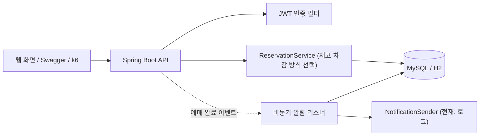
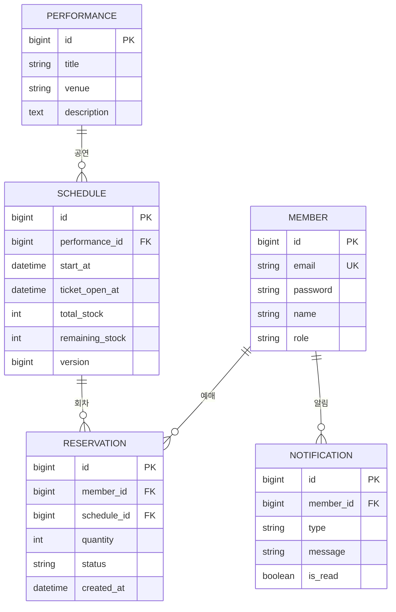

# 🎟️ Ticketing — 공연 티켓 선착순 예매 서비스

인기 공연의 티켓 오픈 순간, 수천 명이 동시에 몰려도 **초과 판매나 중복 예매 없이** 처리하는 예매 서비스입니다.
동시성 문제를 일부러 재현하고, 락 방식을 단계별로 바꿔 가며 **수치로 비교**하는 데 초점을 맞췄습니다.

> 작게 만들고 깊게 판다. 기능 수보다 **문제 → 원인 → 해결 → 수치**가 핵심.

## 주요 기능

- 회원가입/로그인 (Spring Security + JWT), 일반 회원/관리자 권한 구분
- 공연·회차 조회 (페이징, 제목 검색)
- 티켓 예매/취소 (선착순, 재고 제한, 같은 회차 중복 예매 방지)
- 내 예매 내역, **예매 완료·취소 알림** (비동기 이벤트 처리)
- 관리자: 공연/회차 등록·수정·삭제, 티켓 오픈 시간 변경, **판매 현황 대시보드**, **동시성 시연**
- 예매 웹 화면 (`/`), Swagger 문서 (`/swagger-ui.html`)

## 기술 스택

| 구분 | 사용 기술 |
|---|---|
| Backend | Java 17, Spring Boot 3.3, Spring Data JPA, Spring Security, JWT(jjwt) |
| DB | **Oracle 19c** (`oracle` 프로필, 주 DB) / H2(기본, 설치 불필요) / MySQL 8 (`mysql` 프로필) |
| 테스트 | JUnit 5, MockMvc, Awaitility, k6(부하 테스트 스크립트) |
| 인프라 | Docker Compose(MySQL, Redis), Gradle 9 |
| 문서 | springdoc-openapi (Swagger UI) |

## 아키텍처



재고 차감 방식은 `reservation.strategy` 설정으로 고릅니다(`none` / `pessimistic` / `optimistic`).
같은 인터페이스(`ReservationService`)의 구현체를 나란히 두어 **같은 시나리오로 비교**할 수 있게 했습니다.

## ERD



- `RESERVATION`에 `unique(member_id, schedule_id)` → 같은 회차 중복 예매를 DB 차원에서 방지
- `SCHEDULE.remaining_stock`이 동시성 문제의 핵심 지점, `version`은 낙관적 락의 비교 컬럼

## 트러블슈팅: 재고 100장에 요청 1,000건

### 문제 상황
재고 100장인 회차에 1,000명이 동시에 예매하자 **재고보다 훨씬 많이 판매**됐습니다.

### 원인
재고 차감을 "읽기 → 비교 → 감소 → 저장"으로 처리하면, 여러 요청이 같은 재고 값을 동시에 읽고 각자 차감해 덮어씁니다(lost update).
그 결과 재고 카운터는 0인데 예매 기록은 재고의 8~10배가 쌓였습니다.

### 해결
| 방식 | 구현 | 동작 |
|---|---|---|
| 비관적 락 | `SELECT ... FOR UPDATE` (`@Lock(PESSIMISTIC_WRITE)`) | 회차 행을 잠가 요청을 직렬화 |
| 낙관적 락 | `version` 조건부 UPDATE(CAS) + 충돌 시 재시도 | 잠그지 않고 읽은 뒤, version이 그대로일 때만 차감 |

> 낙관적 락에 JPA `@Version`을 쓰지 않은 이유: `@Version`을 붙이면 "락 없음" 비교 구현도 함께 보호되어 초과 판매를 재현할 수 없습니다. 같은 원리를 조건부 UPDATE로 직접 구현해 비교 기준을 유지했습니다.

### 결과 (동시 요청 1,000건, 재고 100, 스레드 64개 · H2 인메모리 기준)

| 방식 | 성공 응답 | 확정 예매 | 초과 판매 | 재시도 |
|---|---|---|---|---|
| 락 없음 | 865~1,000 | 865~1,000 | **765~900건** | - |
| 비관적 락 | 100 | 100 | **0건** | - |
| 낙관적 락 | 100 | 100 | **0건** | 410회 |

- 락 없음의 초과 판매 건수는 4번 실행에서 886, 765, 800, 900건으로 매번 달랐고, 락을 건 두 방식은 매번 0건이었습니다. 한 번은 요청 1,000건이 전부 성공했는데 남은 재고 카운터는 3이었습니다(기록과 카운터의 불일치).
- 낙관적 락은 1,000건 중 410번 충돌해 재시도했습니다. 이 재시도가 낙관적 락의 비용입니다.
- 같은 비교를 **Oracle 19c**에서도 실행했습니다(1회): 락 없음 초과 판매 643건, 비관적 락 0건, 낙관적 락 0건(재시도 851회). DB가 달라도 같은 경향이 나왔고, 낙관적 락의 재시도 횟수는 H2(약 360~410회)보다 늘었습니다.
- 위 표의 수치는 **H2에서 측정한 참고값**입니다. 소요 시간은 단일 측정이라 방식 간 속도 비교에는 쓰지 않았습니다.
- 세부 기록: [`docs/benchmark.md`](docs/benchmark.md)

관리자로 로그인하면 웹 화면의 **동시성 시연**에서 같은 비교를 직접 실행해 볼 수 있습니다.

## 예매 완료 알림 (비동기 이벤트)

예매 응답을 알림 처리 때문에 늦추지 않도록, 예매가 성공한 뒤 이벤트(`ReservationEvents.Confirmed`)를 발행하고 별도 스레드풀(`notificationExecutor`)에서 알림을 저장·발송합니다.
알림 처리가 실패해도 예매에는 영향이 없습니다. 발송부는 `NotificationSender` 인터페이스로 분리해(현재는 로그 출력) 이메일이나 메시지 큐(Kafka 등)로 교체할 수 있습니다.

## 실행 방법

### 1) Docker 없이 바로 실행 (기본, H2)
JDK 17이 필요합니다.

```bash
./gradlew bootRun
```

- 웹 화면: http://localhost:8080/
- Swagger: http://localhost:8080/swagger-ui.html
- 관리자 계정(개발용 기본값): `admin@ticketing.com` / `admin1234`
- 시작할 때 샘플 공연 12개가 들어갑니다(`seed.enabled=false`로 끌 수 있음). H2는 재시작하면 데이터가 초기화됩니다.

### 2) MySQL로 실행 (Docker 필요)

```bash
docker compose up -d
./gradlew bootRun --args='--spring.profiles.active=mysql'
```

### 3) 오라클로 실행 (Docker 불필요, 오라클 DB가 설치된 PC)

SQL Developer 등으로 접속해 앱 전용 계정을 한 번 만든다(`SYSTEM` 같은 관리자 계정으로 실행).

```sql
CREATE USER ticketing IDENTIFIED BY ticketing123 QUOTA UNLIMITED ON USERS;
GRANT CONNECT, RESOURCE TO ticketing;
```

```bash
./gradlew bootRun --args='--spring.profiles.active=oracle'
```

- 접속 주소는 `jdbc:oracle:thin:@//localhost:1521/TESTDB` 이며, 서비스명/계정은 환경변수 `ORACLE_SERVICE`, `ORACLE_USER`, `ORACLE_PASSWORD` 로 바꾼다.
- 테이블은 앱이 시작할 때 자동으로 만든다(`ddl-auto: update`). 기존 테이블에는 컬럼만 추가하고 지우지는 않으므로, **이름이 겹치는 테이블이 있는 스키마(예: 수업용 `scott`)에는 쓰지 않는다.** 회원 테이블은 충돌을 피하려고 `members`로 만든다.

### 테스트

```bash
./gradlew test
```

동시성 비교를 실제 DB(MySQL/오라클)에서 돌리려면 테스트 실행 설정의 VM 옵션에 `-Dspring.profiles.active=oracle`(또는 `mysql`)을 준다.

- `ReservationApiTest`: 가입 → 로그인 → 예매/취소, 중복·재고 초과(409), 권한(401/403), 비동기 알림
- `ReservationConcurrencyTest`: 락 방식별 동시성 비교 (결과가 콘솔에 출력됨)
- `ConcurrencyDemoServiceTest`: 시연 기능과 임시 데이터(공연/회차/예매/시연용 회원) 정리
- 관리자 통계(확정 예매 기준 집계)와 공연 수정·삭제·오픈 시각 변경도 `ReservationApiTest`에서 검증

### 부하 테스트 (k6)
앱을 `mysql` 프로필로 띄운 뒤 실행합니다.

```bash
k6 run -e BASE_URL=http://localhost:8080 k6/reserve.js
```

## API 요약

| 구분 | 엔드포인트 |
|---|---|
| 인증 | `POST /api/auth/signup`, `POST /api/auth/login` |
| 공연 | `GET /api/performances?keyword=&page=&size=`, `GET /api/performances/{id}` |
| 예매 | `POST /api/reservations`, `GET /api/reservations`, `DELETE /api/reservations/{id}` |
| 알림 | `GET /api/notifications`, `POST /api/notifications/read-all` |
| 관리자 | `POST/PUT/DELETE /api/admin/performances`, `POST /api/admin/performances/{id}/schedules`, `PATCH /api/admin/schedules/{id}/ticket-open-at`, `GET /api/admin/stats`, `POST /api/admin/demo/concurrency` |

## 프로젝트 구조

```
src/main/java/com/ticketing
├─ admin/         관리자 판매 현황 통계
├─ member/        회원, 인증(JWT), 관리자 계정 초기화
├─ performance/   공연·회차, 샘플 데이터
├─ reservation/   예매 (락 방식별 서비스), 동시성 시연
├─ notification/  비동기 알림
├─ security/      JWT 필터, 보안 설정
└─ common/        예외 처리, Swagger 설정
```

## 진행 상황과 남은 일

- [x] 회원/공연/예매 API, JWT, Swagger
- [x] 락 없음 → 비관적 락 → 낙관적 락 구현과 동시성 테스트, 수치 비교(H2)
- [x] 예매 웹 화면, 동시성 시연, 예매 완료 알림
- [x] Oracle 19c에서 동시성 비교 실행 (정합성, 재시도 횟수)
- [ ] Oracle 기준 부하 테스트(k6) 수치 측정 — TPS, p95 응답시간, 실패율
- [ ] Redis 분산 락 / Lua 스크립트 원자 연산
- [ ] Testcontainers 기반 통합 테스트, 인덱스·조회 최적화
- [ ] Docker 이미지, GitHub Actions CI, AWS 배포
- [ ] 대기열, 좌석 선택, 결제 연동(테스트 API)
